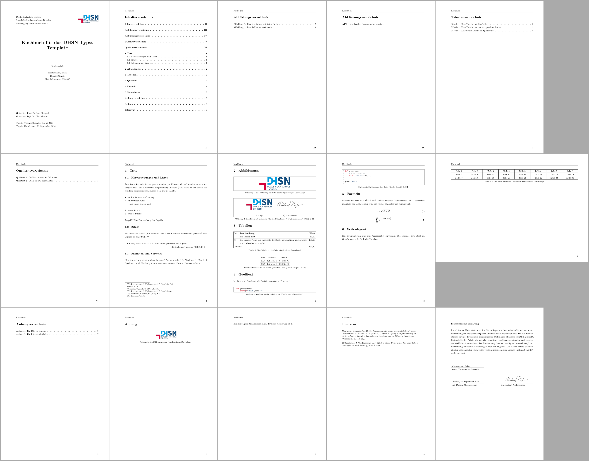

# Cookbook

Snippets for common tasks. All of them are taken from [cookbook.typ](https://github.com/xNycrofox/dhsn-typst-template/blob/main/cookbook.typ), the result can be seen in this [PDF](../assets/examples/cookbook.pdf).

[](../assets/examples/cookbook.pdf)

## Text, lists and abbreviations

```typst
== Hervorhebungen und Listen
Text kann *fett* oder _kursiv_ gesetzt werden. "Anführungszeichen" werden automatisch umgewandelt.
Ein #gls("API") wird bei der ersten Verwendung ausgeschrieben, danach steht nur noch #gls("API").

- ein Punkt einer Aufzählung
- ein weiterer Punkt
  - mit einem Unterpunkt

+ erster Schritt
+ zweiter Schritt

/ Begriff: Eine Beschreibung des Begriffs.
```

## Citations and quotes

```typst
== Zitate
Ein indirektes Zitat.#vglcite(<cloudcomp>)[17-21]
"Ein direktes Zitat."#bacite(<cloudcomp>)[29]
Die Kurzform funktioniert genauso.@rpa[115]
Zwei Quellen an einer Stelle.#vglcite(<cloudcomp>)[40]#super[,]#vglcite(<rpa>)[120]

#quote(block: true, attribution: [Rittinghouse/Ransome (2018), S. 5])[
  Ein längeres wörtliches Zitat wird als eingerückter Block gesetzt.
]
```

## Footnotes and references

Labels are attached to headings with `<name>`, to figures, tables and codes with the `label` argument and to equations with `<name>` behind them.

```typst
== Fußnoten und Verweise <verweise>
Eine Anmerkung steht in einer Fußnote.#footnote[Der Text der Fußnote.]
Auf @verweise, @architektur, @vergleich, @hello und @pythagoras kann verwiesen werden.
Nur die Nummer liefert #ref(<architektur>, supplement: none).
```

## Figures

```typst
#bafigure(label: "architektur")[Eine Abbildung mit fester Breite][
  #image("images/logo.png", width: 6cm)
]

#bafigure(source: captioncite(<cloudcomp>)[12])[Zwei Bilder nebeneinander][
  #grid(
    columns: 2,
    gutter: 1cm,
    align: center + horizon,
    image("images/logo.png", width: 5cm), image("images/signature.png", width: 5cm),
    [a) Logo], [b) Unterschrift],
  )
]
```

## Tables

```typst
#batable(label: "vergleich")[Eine Tabelle mit Kopfzeile][
  #table(
    columns: (auto, 1fr, auto),
    align: (left, left, right),
    table.header([*Nr.*], [*Beschreibung*], [*Wert*]),
    [1], [Ein kurzer Text], [11,10],
    [2], [Ein längerer Text, der innerhalb der Spalte automatisch umgebrochen wird, sobald er zu lang ist], [180,10],
    table.cell(colspan: 2)[Summe], [191,20],
  )
]

#batable(source: [Beispiel GmbH])[Eine Tabelle nur mit waagerechten Linien][
  #table(
    columns: 3,
    stroke: (x, y) => (top: if y < 2 { 0.4pt }, bottom: 0.4pt),
    table.header([Jahr], [Umsatz], [Gewinn]),
    [2024], [1,2 Mio. €], [0,1 Mio. €],
    [2025], [1,5 Mio. €], [0,2 Mio. €],
  )
]
```

- `columns` takes the number of columns or their widths. `auto` fits the content, `1fr` takes the remaining space.
- `table.header` is repeated if the table breaks across pages. Put the table directly into the document instead of a `batable` to allow it to break.
- `stroke: none` removes all lines.

## Code

````typst
Im Text wird Quelltext mit Backticks gesetzt, z. B. `print()`.

#bacode(label: "hello")[Quelltext direkt im Dokument][
  ```python
  def greet(name):
      print(f"Hello {name}!")
  ```
]

#bacode(source: [Beispiel GmbH])[Quelltext aus einer Datei][
  #raw(read("examples/hello.py"), lang: "python", block: true)
]
````

`#raw(read("file"), lang: "python", block: true)` keeps the code in its own file, so it can be executed and tested.
A dark theme is selected with `codetheme: "github-dark"`.

## Math

Put `#set math.equation(numbering: "(1)")` after the show rule of the template to number equations.

```typst
Formeln im Text wie $a^2 + b^2 = c^2$ stehen zwischen Dollarzeichen.
Mit Leerzeichen innerhalb der Dollarzeichen wird die Formel abgesetzt und nummeriert:

$ c = sqrt(a^2 + b^2) $ <pythagoras>

$ sum_(i=1)^n i = (n (n + 1)) / 2 $
```

## Page breaks and landscape pages

```typst
#pagebreak()

#page(flipped: true)[
  #batable[Eine breite Tabelle im Querformat][
    #table(
      columns: (1fr,) * 8,
      ..range(1, 25).map(i => [Zelle #i])
    )
  ]
]
```

## Appendix

```typst
#baappx[
  #bafigure[Ein Bild im Anhang][
    #image("images/logo.png", width: 4cm)
  ]
  #pagebreak()
  #addtoappx[Ein Interviewleitfaden]
  Ein Eintrag im Anhangverzeichnis, der keine Abbildung ist: #theappx().
]
```

## Dates

```typst
// the current date, e.g. "13. Oktober 2026"
returndate: today(),
// a fixed date, printed as "28. September 2026"
returndate: datetime(year: 2026, month: 9, day: 28),
// printed as it is
returndate: "28.09.2026",
```

## Headings without number or entry in the table of contents

```typst
// no number, but listed in the table of contents
#heading(numbering: none)[Danksagung]
// neither number nor entry
#heading(numbering: none, outlined: false)[Danksagung]
```

## A long title in the header

The header shows the title of the paper. Long titles should be shortened to at most 80 characters or removed from the header.

```typst
#show: basimple.with(
  ...,
  headertitle: "A shorter title",
  // or no header at all
  header: false,
)
```
