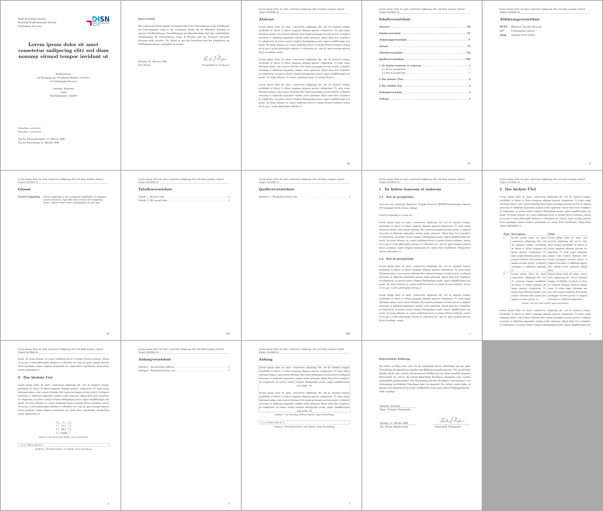

# DHSN Dresden Typst template

A template, which tries to follow the
[DHSN Dresden Styleguide](https://dresden.ba-sn.de/fileadmin/M3__BA_Dresden/downloads/zentrale-dokumente/Leitfaden_wissentschaftliche_Arbeiten.pdf)
as close as possible.
It is the Typst counterpart of the [DHSN Dresden LaTeX template](https://github.com/ba-dresden/ba-latex-template), with which papers and bachelors theses have already passed assessments.
Built with love and sane defaults by [Nuckal777](https://github.com/Nuckal777).
Minor adjustments come from Steffen Greiffenberg [sgreiffenberg](https://github.com/sgreiffenberg).
If this template served you well, do not forget to click the star button on
[GitHub](https://github.com/xNycrofox/dhsn-typst-template).
It will be appreciated.

```warning
 The template might do things wrong and there is no warranty. It is your own responsibility to check for correctness.
```

It gets as simple as shown below.
The code creates a document containing a title page, block notice, table of contents, figures, abbreviations, tables,
a bibliography and an affirmation statement, while setting up correct spacing and page numbering.
Anyway the template is rather customizable, if desired.
The result looks like this ([PDF](assets/examples/simple.pdf)):

[](assets/examples/simple.pdf)

Hooked? Head over to the [quick start](quickstart.md).
New to Typst? The [Typst basics](./usage/basics) explain everything needed to write a paper.
Coming from the LaTeX template? Read the [migration guide](migration.md).

```typst
#import "@local/baarticle:0.1.0": *

#show: basimple.with(
  first: "firstname",
  last: "lastname",
  company: "comp",
  location: "Dresden",
  img: image("images/logo.png"),
  course: "thecourse",
  title: "The title",
  number: 1234567,
  corrector: ("corrector1", "corrector2"),
  themedate: today(),
  returndate: today(),
  signature: image("images/signature.png"),
  companylocation: "Dresden",
  type: "thesis",
)

= Caption
Here is the content of paper.
```

## Features

- title page, block notice, notice on the usage of generative AI, notice on gender language, abstract and affirmation
- table of contents, list of figures, tables, codes, abbreviations and a glossary, which are only created if they have an entry
- roman page numbers in the frontmatter, arabic page numbers afterwards, title in the header
- citations in footnotes with "Vgl." and "ebenda" and a matching bibliography
- figures, tables and codes with a source reference in their caption
- an appendix with its own list of entries
- code highlighting with a light and a dark theme
- no dependencies, a single run of the compiler creates the PDF

## Where to go

| I want to ...                              | Page                                         |
| ------------------------------------------ | -------------------------------------------- |
| write my first paper within minutes        | [Quick Start](quickstart.md)                 |
| learn the syntax of Typst                  | [Typst Basics](usage/basics.md)              |
| know all options of the template           | [Simple Mode](usage/simple.md), [Reference](usage/reference.md) |
| cite sources                               | [Citations](usage/citations.md)              |
| copy a snippet for a table, figure or code | [Cookbook](examples/cookbook.md)             |
| see complete documents                     | [Examples](examples/)                        |
| use the Typst web app or VS Code           | [Setup](setup/)                              |
| build the PDF automatically on GitHub      | [Continuous Integration](setup/ci.md)        |
| switch from the LaTeX template             | [Migrating from LaTeX](migration.md)         |
| solve a problem                            | [FAQ](faq.md)                                |
